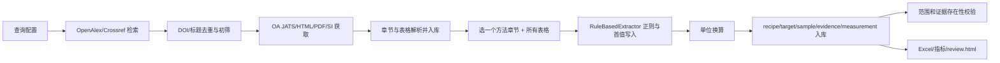

# AlScN PVD 文献数据提取项目审计报告

审计日期：2026-10-30。对象：`<repo-root>`，重点为现有 `data/structured/corpus.sqlite3`、逐篇抽取 JSON 和 `docs/review.html`。本次只读分析代码、现存解析文本与数据，未运行爬虫、模型调用或改写业务数据。项目内未发现额外 `AGENTS.md`。

## 1. 项目现状总结

项目已有 OpenAlex/Crossref 检索、去重和初筛，OA 全文获取，JATS/HTML/PDF 解析，章节定位，规则式工艺抽取，SQLite、Excel、指标和静态审核页。依赖主要为 requests、PyYAML、lxml、pypdf；Excel 导出使用 openpyxl，但它未列入 `pyproject.toml` 的依赖。`tests/` 有阶段性测试，现存报告称 153 项通过；本审计未重新执行测试。项目的**文献获取能力可保留；工艺结构化结果尚不能作为可信科学数据库**。

当前库的只读盘点：96 篇 paper、136 个 document、795 个 section、45 个 table、71 条 recipe、39 条 target、**1 条 sample**、32 条 measurement、462 条 evidence、111 条 review_queue。71 条 recipe 的 `recipe_id` 全为 `R1`。这些是库内计数，不代表论文真实配方数或字段召回率。

## 2. 数据流程分析

| 模块与关键位置 | 输入 → 输出、处理与 AI | 主要风险 |
|---|---|---|
| `app/cli.py:153,166,244,333,361` | CLI 驱动 search/ingest/extract；只有 search 可选 LLM | `--force` 可清理旧抽取，审计未使用 |
| `app/clients/{openalex,crossref}.py`、`app/discovery/{pipeline,dedup,screening}.py` | API 元数据 → paper/初筛；DOI 规范化，缺 DOI 用标题等线索；可选标题摘要 LLM 分类 | 预印本与正式 DOI 的实验实体关联未贯穿抽取 |
| `app/acquisition/service.py:103-260`、`{jats,html,pdf,grobid}.py` | OA 全文/SI → document、section、table；JATS 优先，PDF fallback | PDF fallback 不抽表；SI 有数量上限与失败状态 |
| `app/acquisition/sections.py:155-190` | 章节评分 → `deposition_methods` 标记 | 仅一个最高分章节成为主要方法段 |
| `app/extraction/pipeline.py:25-124` | 所有 section/table → `RuleBasedExtractor` → DB/JSON；**无字段 LLM** | 所有表格拼接、样品 ID 冲突、逐实体提交 |
| `app/extraction/extractor.py:105-403` | 一个方法段 + 所有表格 → 固定一条 R1/S1、最多一靶 T1；正则按首值 | 层、步骤、靶、样品混淆；遗漏后续候选 |
| `app/extraction/units.py:25-68` | 原始数值/单位 → 标准值 | 只换算数值，不核实实体归属 |
| `app/extraction/performance.py:43-101` | 全部非 references 章节 → 测量 | 固定关联 R1/S1，测试条件空白 |
| `app/storage.py:231-323,969-1167` | 对象 → SQLite upsert | 缺实验组/层/步骤关系；S1 全库冲突 |
| `app/normalize/validator.py:25-98` | recipe + evidence → 审核项 | 只检数值范围和证据存在，不检语义支持/漏项 |
| `app/export/excel.py:23-42`、`app/review/html.py:48-90`、`app/evaluation/metrics.py` | DB → Excel/静态页/覆盖率 | 原错误照搬；覆盖率和证据率不是准确率/召回率 |

**AI 范围澄清**：`app/discovery/llm.py:52-104` 仅对标题和最多 4000 字符摘要做可选 JSON 分类；默认 `--classifier heuristic` (`app/cli.py:63`)。工艺抽取在 `pipeline.py:21` 固定实例化规则提取器；两篇指定论文的 `extraction_runs.model=rule-based, prompt_version=none`。所以不存在工艺抽取的 DeepSeek 输入、原始回答、Prompt 或“AI 结果被后处理改错”这一链路。现有 `data/structured/extractions/*.json` 是规则的直接输出，不是模型回答。

## 3. 已确认问题及逐篇错误链

以下均由**现存数据库解析章节 → 抽取 JSON → SQLite → 审核页**交叉确认；引用位置为项目相对路径。原始 JATS/PDF 可供进一步人工核对；本审计对“原文”采用本地保存的解析全文，未独立校对所有原版页面。单位换算在下述两个指定案例中没有把正确值改错，错误已出现在规则抽取 JSON。

### P0-1：层厚度与沉积步骤错配

**复现/证据**：`10.1002/advs.202500611` 的库中 `Thin Film Deposition / jats:sec:5` 同时写明 `250 nm-Mo/20 nm-AlN/Si` 与 nitride layer `365 nm`。抽取 JSON 的 `alscn_thickness_nm=250`，evidence 指向 Mo 衬底堆栈句；SQLite 及 `docs/review.html` 同为 250 nm。`app/extraction/extractor.py:300-308` 在整段中先取 `_THICKNESS_RE` 第一处、仅用同句出现 `film` 判定，未绑定材料层。**影响**：电极厚度可冒充功能膜厚度。**修复**：先解析层实体及上下关系，厚度必须与 AlScN/nitride 层的明确主谓或表格行关联；冲突进入候选审核。回归断言本例 365 nm、Mo 250 nm 分属不同层。

**第二例**：`10.48550/arxiv.2501.02101` 的 `Methods / pdf:p4` 明示 10 nm Ti 黏附层、100 nm Pt 背电极、之后 AlScN；抽取 JSON/DB/审核页却把 10 nm 记作 AlScN。相同规则 `extractor.py:300-308` 的同句 `films` 触发误配。`30 W / 8 min` 来自沉积前 RF Ar 刻蚀，分别被 `target1_power_w` 和 `deposition_time_min` 取走，位置为 `extractor.py:220-238,309-315`。功率过滤仅排除 electrode/TiN，没有排除 etch/pre-treatment。**修复**：定义清洗、预处理、电极、功能层、退火、图形化、测量的步骤边界；字段归属步骤，未确定时留空。

### P0-2：气体、靶材和功率关系失真

第二例解析文本明确为 `20 sccm for Ar and 12 sccm for N2`，DB 却存 `ar_flow_sccm=12` 且缺 N2。`extractor.py:32-40,273-281` 的 `_GAS_RE` 可从 `Ar` 跨过 `20 sccm ... and` 抓到 12，后续 `set_field` 首值锁定；后缀匹配只捕获 `sccm Ar` 而非 `sccm for Ar`。本例还有 `5 µbar` 工作压力，`extractor.py:27-30` 不识别 µbar，因此遗漏。**修复**：气体名与数值在同一表达式/配对结构内绑定，并覆盖 `N2:Ar=a:b`、`a sccm for Ar` 等语法；µbar 加入单位表与校验。

第一例 JATS 写明独立 Al (5N5)、Sc (3N) 靶，Al 靶固定 800 W，Sc 靶功率变化；JSON/DB 却只有一靶 `AlSc alloy 800 W`。`extractor.py:233-238,340-360,476-484` 从**整段**含 `AlSc` 推断合金，只构造 T1，未把功率句与 Al 靶绑定。第二例虽识别 `Al/Sc` 字串，也仍只有 T1，30 W 来自刻蚀。**修复**：靶材作为多个独立实体，材料、纯度、功率、功率密度及证据逐靶关联；不凭整段材料词合并靶。

第三个已存追踪样例 `10.48550/arxiv.2506.22212`：解析段给 AlScN 的 `N2:Ar=160:32 sccm`、AlN 的 `95:15`；JSON/DB 记 N2=32、Ar=15。`extractor.py:32-40,273-281` 混合两个层的气体；同例 `single target` 来自整段 `single uninterrupted vacuum cycle` (`:465-473`)，`AC` 来自 C-V 测试 (`:92,:164`)，`AlN` 超晶格被当衬底 (`:93-97,:325-328`)。该例项目已有 `docs/extraction_trace/10.48550_arxiv.2506.22212/07_error_analysis.md`，与本次 DB 检查一致。

### P0-3：Recipe 与 Sample 的身份关系错误

`extractor.py:150-152,379-398` 固定每篇 `R1/S1`，只返回一个 Recipe；数据库可存多行，但提取器不会生成。第一例 JATS 明列 AlN、15SAN、ugSAN、dgSAN、28SAN 五类，第二例 `9×5` 网格、每库 45 样品和成分/厚度梯度，都仅存 R1。这里不能简单把第一例认作“五个完整 Recipe”：其中梯度样品的功率序列需要原文/SI 重建；但**一论文一 R1 已确认不够**。

更严重的是 `samples.sample_id` 为**全库主键** (`storage.py:257-262`)，`save_sample` 按 S1 upsert (`:1023-1035`)；当前 71 Recipe 只剩一条样品，归属于 `10.1063/1.5084945`。`performance.py:69-70` 却把每条测量的 sample_id 写成 `doi:...:S1`；当前 32/32 条测量的 sample_id 在 samples 表均无对应记录。**修复**：paper 作用域的稳定样品主键与外键，区分实验组、recipe、实际样品/网格位置和测量；迁移前保存旧库副本、做映射核对。回归断言 71 个不同 paper 的样品不互相覆盖，测量外键有效。

### P0-4：其他科学值可错误归属或换算

`10.3390/mi15050624` 的 JATS 解析段写明**薄膜** Sc 含量 9.6%，DB 同时记 `film_sc_at_pct=9.6` 与 `target1_sc_at_pct=9.6`；后者由 `extractor.py:82-89,240-257` 的宽泛 `_SC_TARGET_RE` 产生，证据并未说靶材 9.6%。同篇 `substrate_material=Mo` 来自 Mo/AlScN/Mo 堆栈 (`:93-97,:325-328`)，不是 CSOI 晶圆。另有 `performance.py:26` 将 `kV/cm → MV/cm` 因子写成 0.1，正确为 0.001；这是代码已确认的换算缺陷，当前库中是否有被其影响的记录尚未逐条核验。**修复**：成分实体判别、衬底关系判别、单位常量测试及历史数据筛查。

### P1-1：完整性无可证明保障

`extractor.py:136-149` 只选一个 `deposition_methods/methods` 章节，其他 Methods/Results/SI 工艺段被忽略；所有表格拼成一段但丢表格行、编号与局部归属。`set_field` 在 `:185-186` 对同名字段只保留首值；证据 ID 为 `record_id:field_key` (`:421-439`)，不容多个候选。PDF fallback `acquisition/pdf.py:107-115` 返回空 tables。`extractor.py:376` 把缺值写作 `null = not reported`，但当前无法区分未报告、未获取 SI、解析失败、章节没读、模式没命中。指标 `docs/extraction_metrics.md` 的字段覆盖率、100% 数值字段有 evidence，并非原文支持率或召回率；前述错误字段同样附有 evidence。**修复**：文档覆盖清单与失败状态，逐章节/表格/图注/SI 候选枚举，字段候选保留，人工金标准驱动召回检查。

### P1-2：校验和审核系统不足

`validator.py:25-79` 只看范围、证据记录有无、压力大小等；上述错误都在合理数值范围内，且有无效证据，故不会拦截。`review/html.py:11-44,48-90` 是静态只读预览，仅渲染已抽到字段；没有逐字段确认、修改、拒绝、完整原文定位、缺失字段清单、审核历史或反馈测试的工作流。库有 recipe 的 `review_status` 和 review_queue，但页中只有显示，非可编辑审核系统。现阶段水平为**结果展示页**。

### P2：可维护性与重跑风险

`pipeline.py:25-27` 的 `force` 调 `storage.py:1222-1231` 清旧 recipe/target/sample/evidence/review_queue；但该函数未清 measurements，且 `save_recipe` upsert 会把审核状态重置为 `new` (`storage.py:975-981`)。这是潜在遗留数据/审核记录丢失风险；本审计没有执行 `--force`。`pipeline.py:63-103` 和 storage 的逐行 commit 缺少跨实体事务，失败时可留下部分写入。`app/export/excel.py` 使用未声明的 openpyxl 依赖。修复重跑流程前需先建快照及迁移检查。

## 4. AI 提取系统专项审计

**实际策略**：没有工艺字段 LLM 模型、Prompt、分块、token 截断、JSON Schema 或 AI 失败重试。`discovery/llm.py:52-104` 仅可选初筛，使用运行时配置模型、`temperature=0`、`json_object`；校验仅检查 label 枚举及置信度。当前配置通过环境变量指定 URL/模型且默认关闭，不能断言使用了 DeepSeek。工艺提取不应归因于模型能力。

**上下文策略**：不是 token 分块，而是整个选中章节与所有表格串接。系统可能因为只选一节、PDF 表格缺失、SI 未成功解析而漏信息；没有证据表明当前规则提取存在静默的 token 截断。首值覆盖、跨句匹配、全段关键词推断比“长上下文”更直接地解释现存错误。

**Prompt 评价**：当前不存在工艺抽取 Prompt，因此分层、工艺阶段、多靶、多 Recipe、固定/变量、引用值、证据、空值要求均未实现。未来应先生成文档结构与候选证据，再用受约束的模型建立实体关系，最后做独立证据验证；不建议把全部任务塞进单次宽表生成。

## 5. 数据模型与审核系统评价

现有 Paper、Recipe、Target、Sample、Measurement、Evidence 表支持基本列表和字段证据；Recipe 表可容多行，但生成器只输出一行。缺 Experimental Group、Layer、Process Step、Sample Position/测量点；Evidence 只能按 `record_id:field_key` 唯一存一个字段候选。`samples` 的全局 `S1` 主键和 measurement 不一致是实际数据损坏。`targets` 长表设计值得保留，但需要按步骤/层/recipe 关联多个靶；`measurements` 需要真实 sample、测试条件和结果归属。建议增加关系表/外键及版本化迁移，暂不要求更换 SQLite。

## 6. 修复优先级

| 顺序 | 必须 | 模块 | 兼容性风险 | 验证门槛 |
|---|---|---|---|---|
| 1. 冻结现有结果并标记不可信 | 是 | DB、导出、审核 | 对下游筛选有影响 | 现有 71 条均保留、审核状态可追溯 |
| 2. 修样品 ID、测量外键与重跑事务 | 是 | extractor、performance、storage、pipeline | 高，需 DB 迁移 | 71 条不互覆，32 条测量可定位样品；重跑保留历史 |
| 3. 建 Layer/Step/Target/Group/Recipe 关系与多候选证据 | 是 | schema、storage、extraction | 高，Excel 需兼容映射 | 两指定论文层/步骤/靶归属正确，多 Recipe 结构可表达 |
| 4. 改气体、压力、功率、厚度、成分与单位规则 | 是 | extractor、units、performance | 中，历史值变化 | 四个本文案例回归，kV/cm 因子正确 |
| 5. 全文/SI/表格覆盖与完整性记录 | 是 | acquisition、sections、extraction | 中 | 每源状态、未报告与未处理区分；表格行可定位 |
| 6. 校验与审核闭环 | 是 | validator、review、evaluation | 中 | 错层、错步骤证据被挡；人工可改、拒、保存历史 |
| 7. 评估 LLM 分阶段抽取 | 条件性 | 新抽取层 | 成本和结果格式 | 与规则基线在盲审金标准上比较，不能先承诺更高准确率 |

## 7. 下一阶段实施计划与验证方案

各任务为独立开发包，**本阶段未实施**。

1. **金标准与追踪包**：`tests/gold_standard/` 新建 3–5 篇逐字段、逐实体人工标注，保存原版页码/表号、解析片段、规则 JSON、DB/页对照。优先用本报告四篇：两指定错误、`2506.22212` 多层超晶格、`mi15050624` 薄膜/靶成分冲突；再选一篇单配方和一篇 SI 参数分散论文。依赖：原文和 SI 可读。验收：双人复核分歧清单及版本号。
2. **身份与迁移**：改 `app/extraction/{extractor,performance,pipeline}.py`、`app/storage.py`；定义 `paper_key:sample_local_id`，外键和事务，历史快照与只读迁移演练。依赖任务 1 的实体标注。验收：全库无孤儿 measurement，重跑不抹人工审核。
3. **实体建模和候选生成**：扩 `config/alscn_pvd_schema.json`、`app/extraction/models.py`、`app/storage.py`、`extractor.py`，显式 Layer/Step/Group/Recipe/Target、变量范围及多个候选证据；兼容旧 Excel 视图。依赖任务 1–2。验收：四例能够无信息覆盖地表达。
4. **解析覆盖和规则修正**：改 `app/acquisition/{pdf,jats,service,sections}.py`、`app/extraction/{extractor,units,performance}.py`；保留段落/表格结构，独立解析气体与各步骤；增加语义校验。依赖任务 3。验收：指定错误逐项回归，未读取来源有明确状态。
5. **审核与度量**：改 `app/review/html.py` 或新增服务、`app/normalize/validator.py`、`app/evaluation/metrics.py`；字段候选确认、修改、拒绝、页码定位、遗漏清单、审计日志和回归导出。依赖任务 3–4。验收：人工修改可保存并重放，旧版/新版可比。
6. **可选 LLM 对照实验**：在固定的盲审集上对比规则与“候选发现 → 关系组装 → 证据验证”方案；记录模型、Prompt 版本、原始输出、成本和失败状态。依赖前五项。验收：报告字段准确率、召回率、Recipe 识别率、证据有效率、严重错配数及置信区间；达不到门槛则不替换基线。

**指标定义**：字段准确率 = 正确的已抽字段 / 所有已抽字段（数值、单位、实体/步骤均须正确）；召回率 = 正确抽出的人工标注字段 / 所有应抽字段；Recipe 识别率按人工标注的组/配方匹配；证据有效率 = 真正支持该实体字段的证据 / 所附证据；严重错误按错层、错步骤、靶/膜混淆、引用值误用、跨 Recipe 合并分类。当前缺逐篇完整人工标注，**不能声称已测得真实 Precision/Recall**。本报告四例是故障定性样本，不是随机统计样本。

## 8. 总体判断

1. **架构适合扩展吗？** 检索、获取、解析与存储分层可沿用；当前工艺抽取与身份关系不适合直接扩展为可信数据库。
2. **主要错误在哪？** 已知两个 DOI 的正确句子在解析文本中，错在规则匹配/实体归属；样品关系另有存储主键缺陷。PDF 表格/SI 缺失会另造成遗漏。未发现工艺 LLM 参与。
3. **保留哪些？** HTTP/缓存、OpenAlex/Crossref、合法 OA 获取、JATS 章节和表格保存、SQLite 基础框架、原始证据与导出能力。
4. **必须重构哪些？** `RuleBasedExtractor` 的扁平首值逻辑、样品/测量 ID、步骤/层关系、证据候选与校验、审核闭环。
5. **要换 LLM 吗？** 当前无工艺 LLM 可换；先建金标准，再评估是否引入模型及哪种模型。
6. **单次还是分阶段？** 分阶段候选发现、实体/配方组装、独立证据验证和人工复核。
7. **能用于工艺统计吗？** 不能直接使用当前 71 条原始 Recipe；必须先逐篇校正并完成实体关联与质量标记。
8. **还缺什么？** 多层/多步骤/多 Recipe 模型、SI/表格完整性清单、多候选证据、样品外键、语义验证、可写审核历史和人工金标准回归。

### 证据范围与未决事项

本报告确认了上述四篇的现存解析文本、规则 JSON 与 corpus SQLite；`docs/review.html` 两指定 DOI 对应值也一致。尚未独立逐页核对四篇的原版 PDF/JATS 排版与所有 SI，不能据此断言每篇所有应抽字段。正式 DOI `10.1063/5.0267904` 在现存记录中是单独的元数据/全文不可得条目；本次第二例追踪的是其 arXiv 对应版本 `10.48550/arxiv.2501.02101`，两个 DOI 的版本归并仍待人工确认。
